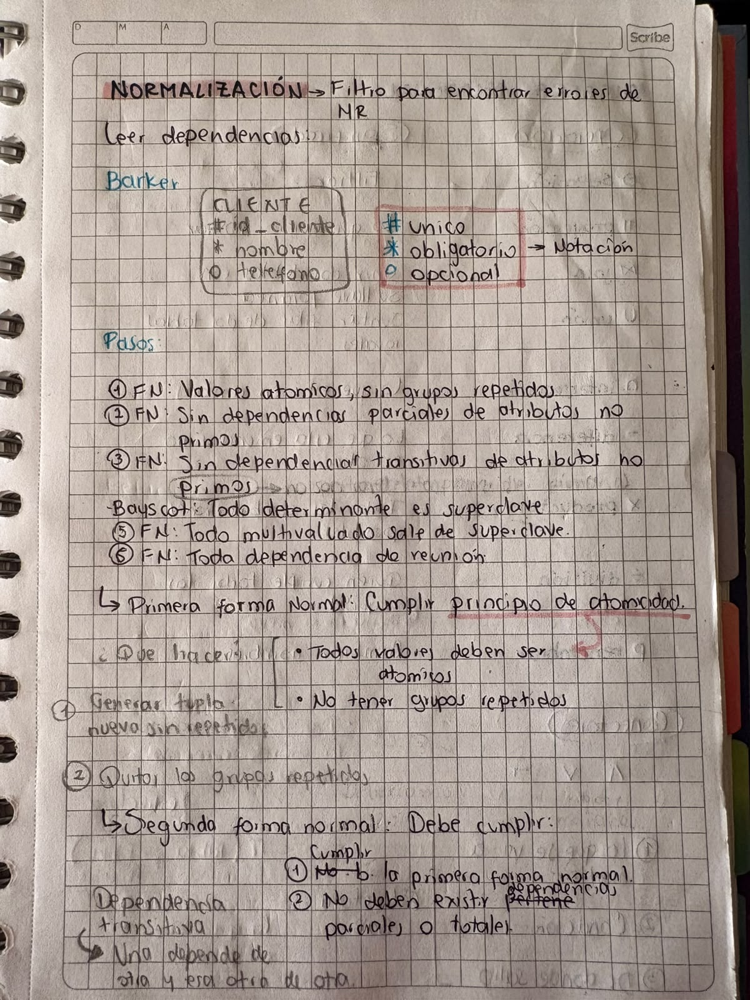

Aquí continúo con las actividades que realizo en la clase de bases de datos: lo que aprendí y cómo fue cada ejercicio.

---

## Normalización

### ¿Qué se aprendió en clase?

° La foto anterior muestra algunos de los apuntes tomados en clase que ayudaron al mejor entendimiento del tema.
° La normalización es un proceso que sirve para organizar las tablas de una base de datos, evitando datos repetidos y problemas al insertar, actualizar o eliminar información.

° Se realiza por etapas llamadas formas normales:

1. Primera Forma Normal (1FN): cada campo debe tener un solo valor (valores atómicos) y no debe haber grupos repetidos.
2. Segunda Forma Normal (2FN): además de estar en 1FN, todos los atributos deben depender de la llave primaria completa, no solo de una parte de ella.
3. Tercera Forma Normal (3FN): además de estar en 2FN, ningún atributo debe depender de otro atributo que no sea llave (no debe haber dependencias transitivas).

---
