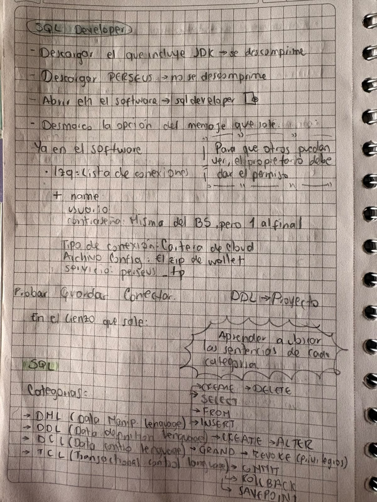
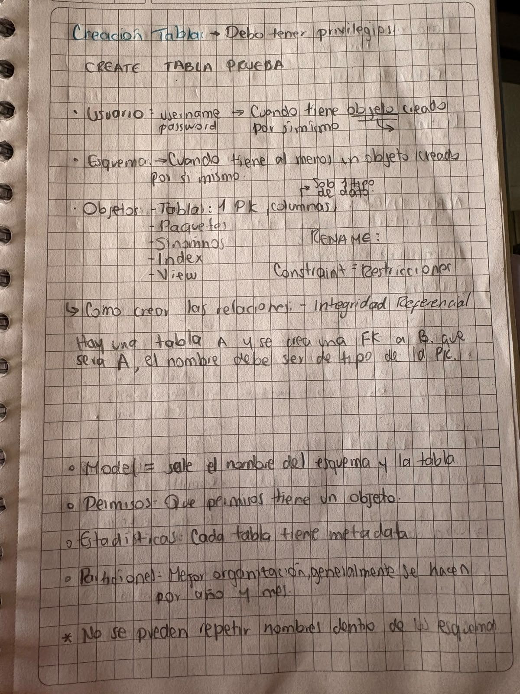

## Álgebra Relacional

### ¿Qué se aprendió en clase?

° El álgebra relacional es un lenguaje formal que permite hacer consultas sobre las tablas (relaciones) de una base de datos. Cada operación recibe una o más tablas y devuelve una tabla nueva.

° Es la base teórica de SQL: lo que se escribe en SQL se puede expresar con operaciones del álgebra relacional.

° Sus operaciones principales son:

1. Selección (σ): filtra las filas que cumplen una condición. Equivale al WHERE en SQL.
2. Proyección (π): escoge solo algunas columnas. Equivale a las columnas que se ponen en el SELECT.
3. Unión (∪): junta las filas de dos tablas compatibles, sin repetir.
4. Diferencia (−): deja las filas que están en una tabla pero no en la otra.
5. Producto cartesiano (×): combina cada fila de una tabla con todas las filas de la otra.
6. Renombrar (ρ): le cambia el nombre a una tabla o a sus atributos.
7. Reunión o Join (⋈): combina dos tablas a partir de un atributo en común. Equivale al JOIN en SQL.

° Ejemplo: para obtener el nombre de los estudiantes de la carrera de Ingeniería se escribe:

π nombre ( σ carrera = 'Ingeniería' ( Estudiante ) )

Primero se filtran los estudiantes de Ingeniería (σ) y luego se muestra solo su nombre (π).

### Clase

El docente explicó en clase mas a fondo con ejemplos y operadores como el producto cartesiano."

---

## SQL

### ¿Qué se aprendió en clase?

° SQL es el lenguaje que se usa para crear, consultar y manipular bases de datos relacionales.

° Sus comandos se dividen en grupos, por ejemplo:

1. DDL (definición de datos): CREATE, ALTER y DROP, para crear o modificar tablas.
2. DML (manipulación de datos): INSERT, UPDATE y DELETE, para agregar, cambiar o borrar registros.
3. Consultas: SELECT, junto con WHERE, ORDER BY, GROUP BY y JOIN, para obtener la información que se necesita.

---
-->
