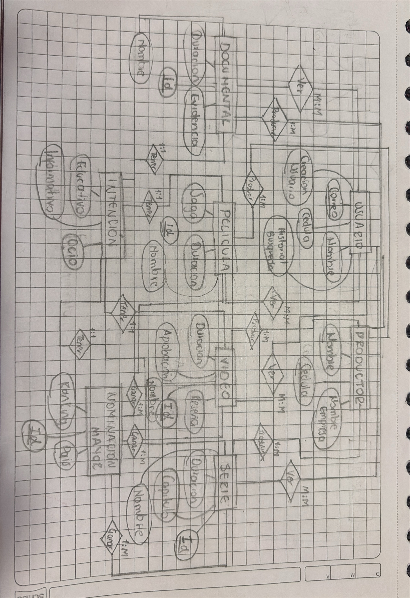
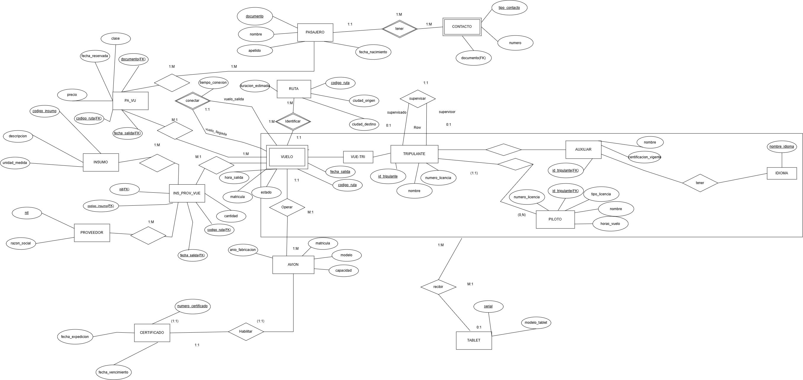

Aquí voy dejando las actividades que realizo en la clase de bases de datos: lo que aprendí y cómo fue cada ejercicio.

---

## Modelo Entidad Relación

### ¿Qué se aprendió en clase?

° El modelo entidad relación es una estructura para organizar los datos y ver las relaciones de los datos.

° M E R tiene cinco elementos principales que ayudan a la mejor realización de este, como: Entidades, Atributos, Atributos Clave, Relaciones y Cardinalidades.

### Ejercicio realizado

Para la creación del primer modelo se debía leer cuidadosamente los requerimientos, y a partir de estos sacar las entidades y sus atributos, así como las relaciones y las cardinalidades.

El ejercicio se logró exitosamente, sin embargo, hay aspectos a mejorar...

---

## Transformación MER

### ¿Qué se aprendió en clase?

Para la transformación del Modelo Entidad Relación se deben tener en cuenta ciertas reglas que ayudan a sus cambios, por ejemplo:

1. Tener en cuenta la cardinalidad en las relaciones de las entidades, pues de acuerdo a cada una y en conjunto con su participación se hace una transformación correspondiente.
2. Que tipo de atributo tienen las entidades, si es multivaluado o compuesto se deben transformar, si es derivado ya no hace parte de la transformación, se "quita" del modelo.
3. La generalización/especialización se debe notar de que tipo es, si solapada, disjunta, total... Pues requiere seguir unas reglas en especifico.

### Ejercicio realizado

Este fue el primer taller realizado, consistía en leer atentamente las características de un modelo el cual luego de tenerlo debíamos transformarlo. Fue un ejercicio un poco complejo pues es el primer taller donde se debe aplicar el conocimiento previo, haciendo que hayan muchas confusiones y demás. Sin embargo, luego de varias pruebas y errores se logró completar la realización del taller.

---

<!--
## Título de la siguiente actividad

### ¿Qué se aprendió en clase?

Texto.

### Ejercicio realizado

Texto.

---
-->
