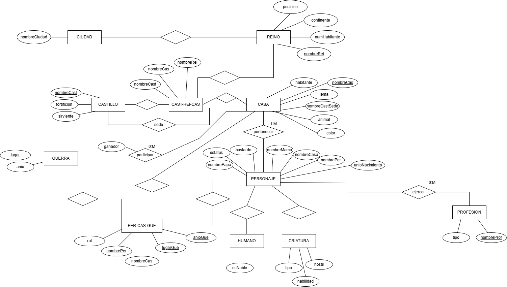

El modelado es el primer paso para diseñar una base de datos: a partir de unos requerimientos se identifican los datos que se deben guardar y cómo se relacionan entre sí. Aquí reúno lo más importante del tema y las evidencias de los talleres que realizamos en clase.

---

## Conceptos clave

### Elementos del Modelo Entidad Relación

| Elemento | Qué es | Cómo se dibuja |
| --- | --- | --- |
| Entidad | Objeto del mundo real del que se guarda información (ej. PERSONAJE) | Rectángulo |
| Atributo | Característica de una entidad (ej. nombre, año de nacimiento) | Óvalo |
| Atributo clave | Atributo que identifica de forma única a cada registro | Óvalo con el nombre subrayado |
| Relación | Asociación entre dos o más entidades (ej. pertenecer) | Rombo |
| Cardinalidad | Cuántos registros de una entidad se relacionan con otra (1:1, 1:N, N:M) | Se escribe sobre la línea |

### Reglas de transformación a tablas

| Caso | Cómo se transforma |
| --- | --- |
| Entidad fuerte | Se convierte en una tabla con su llave primaria |
| Entidad débil | Tabla cuya llave es la llave de la entidad de la que depende (FK) más su clave parcial |
| Atributo multivaluado | Pasa a ser una tabla nueva relacionada con la entidad |
| Atributo compuesto | Se descompone en sus atributos simples |
| Atributo derivado | Se elimina, porque se puede calcular a partir de otros datos |
| Relación 1:N | La llave del lado "1" pasa como llave foránea al lado "N" |
| Relación N:M | Se crea una tabla intermedia con las llaves de ambas entidades y los atributos de la relación |
| Especialización | Se transforma según sea disjunta o solapada, total o parcial |

---

## Evidencia 1: MER de Juego de Tronos

En este ejercicio construí el Modelo Entidad Relación del universo de Juego de Tronos, la guia fue sacada de un enunciado online que hablaba sobre el Juego de Tronos. Pude identificar entidades como REINO, CIUDAD, CASA, CASTILLO, PERSONAJE, GUERRA y PROFESIÓN, con sus atributos y atributos clave. También modelé una especialización de PERSONAJE en HUMANO y CRIATURA, y relaciones entre varias entidades como la participación de personajes y casas en las guerras.

**Lo que aprendí:** Este ejercicio me permitió entender mucho mejor como funciona realmente la construcción de un MER. Por otro lado, lo que se me dificultó mucho fue el tema de la participación y cardinalidad, pero con ayuda del docente y mis compañeros de clase pude entender mejor el ejercicio. 

---

## Evidencia 2: Taller 1 – Transformación del modelo (Aerolínea)

Taller realizado en grupo, en el que analizamos y transformamos a tablas un modelo de una aerolínea con pasajeros, rutas y vuelos. Se trabajaron cinco ejercicios:

1. Transformación de atributos (multivaluados, compuestos y derivados).
2. Transformación de relaciones N:M con atributos.
3. Relación ternaria y agregación.
4. Especialización y relaciones recursivas.
5. Análisis crítico de un modelo transformado.

<a class="button" href="/tallerAvion.pdf" target="_blank" rel="noopener">Ver taller (PDF)</a>

**Lo que aprendí:** Aprendí mediante el taller la identificación de cuales son las entidades que deben haber, sus atributos y sus relaciones. También el taller permitió profundizar en el concepto de agregación, y demás conceptos que no estaban del todo claros. 

---

