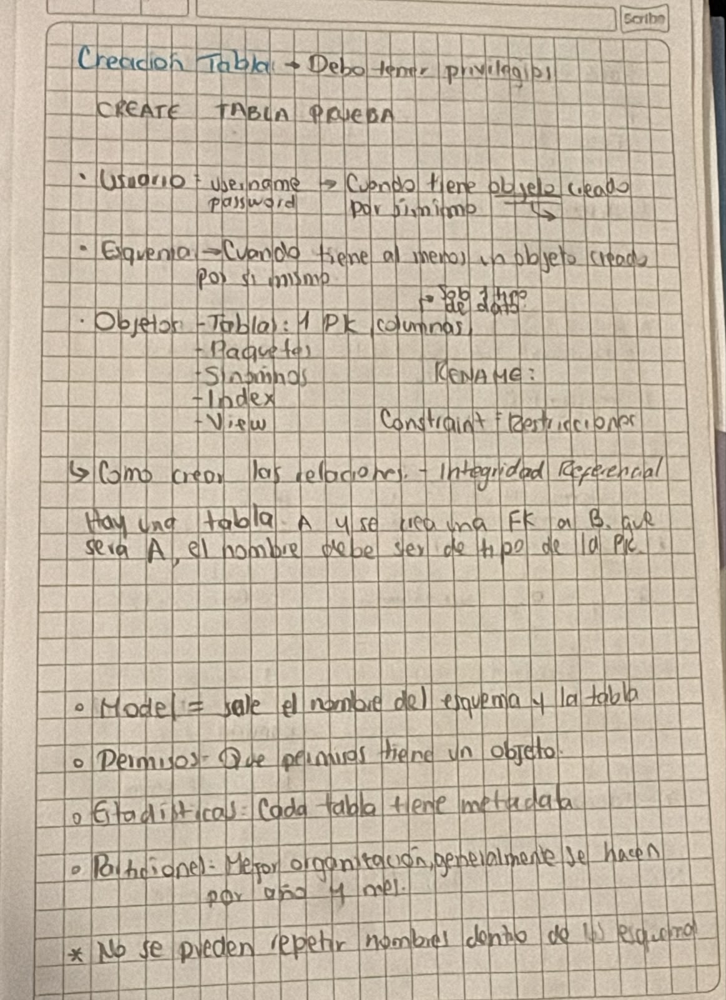
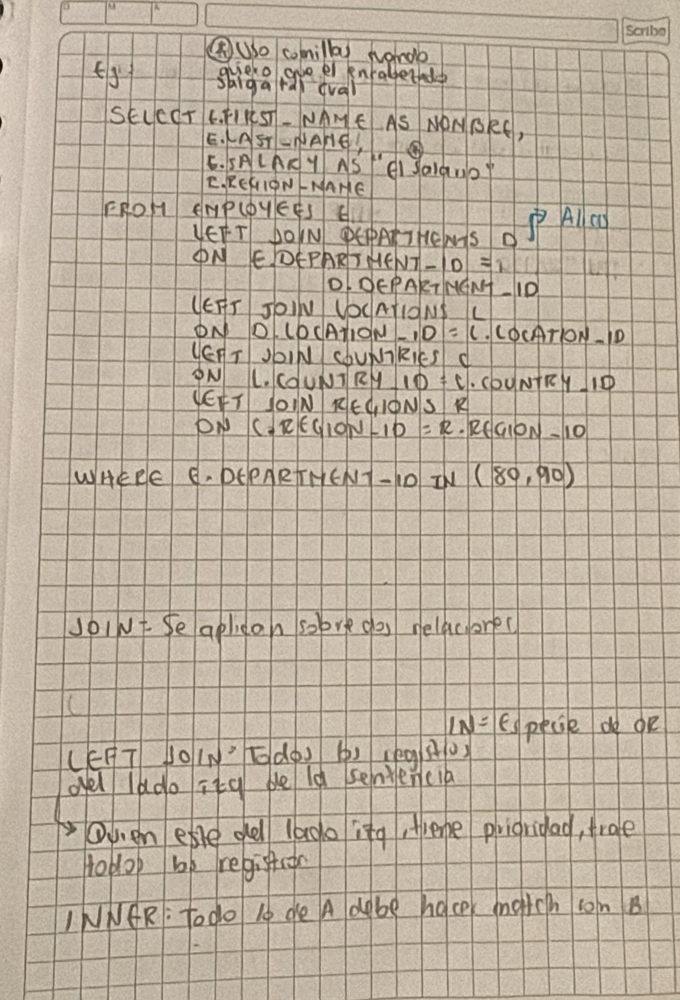
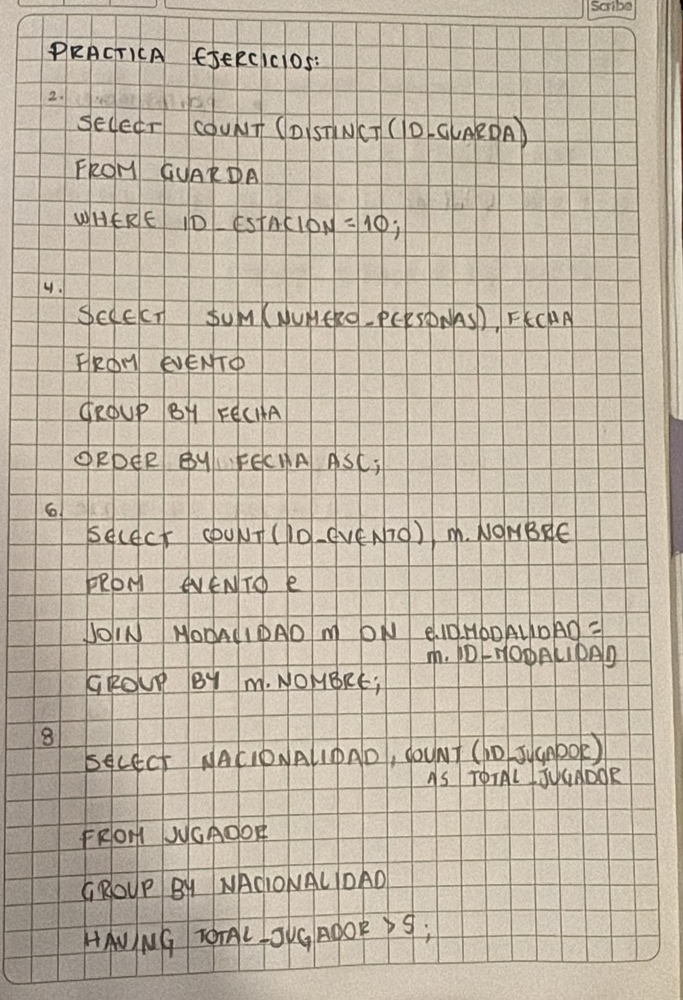
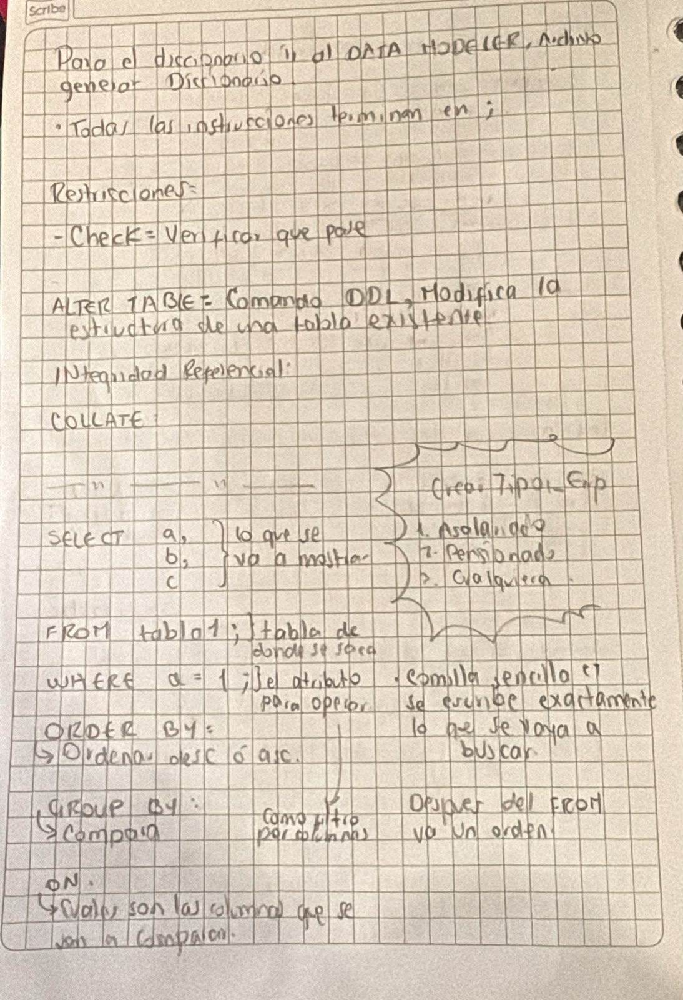

SQL (Structured Query Language) es el lenguaje que se usa para crear, consultar y modificar bases de datos relacionales. Aquí explico los temas principales que vimos en clase, y junto a ellos capturas de los apuntes que ayudaron al mejor entendimiento de estos. 

01

### Definir la estructura (DDL)

Con los comandos DDL se crea y se modifica la estructura de la base de datos: las tablas, sus columnas, sus tipos de datos y sus llaves. Los principales son **CREATE**, **ALTER** y **DROP**.

02

### Manipular los datos (DML)

Con los comandos DML se trabaja sobre los registros de las tablas: **INSERT** agrega filas, **UPDATE** las modifica y **DELETE** las elimina. Con UPDATE y DELETE siempre se debe usar WHERE para no afectar toda la tabla.

03

### Consultar (SELECT)

**SELECT** permite obtener la información que se necesita. Se combina con **WHERE** para filtrar, **ORDER BY** para ordenar y **GROUP BY** para agrupar junto con funciones como COUNT, SUM o AVG.

04

### Unir tablas (JOIN)

Como la normalización separa los datos en varias tablas, **JOIN** sirve para volver a juntarlos usando las llaves que tienen en común. Hay varios tipos: INNER, LEFT, RIGHT y FULL JOIN.

**Lo que aprendí:** Debo aceptar que se me hizo un poco confuso al inicio el hacer sentencias, pues requiere de un orden y entender muy bien que se quiere buscar, pero creo que es cuestión de practica, y creo que con el tiempo he venido mejorando respecto con este tema.
